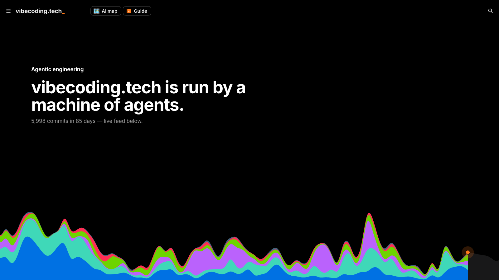

# Machine Day

**Agentic development. A machine day in one minute.**

**[Live demo](https://machine-day.vercel.app)**



A dark, scroll-driven landing page that turns a repository's history into a
live story: commit "dunes" by type of work, a terminal with the latest
commits, a one-minute timelapse of a whole day of pipeline events, a
clickable map of the repository, a price / speed / quality comparison with a
team, and footnotes with the methodology.

It is the page that runs live at [vibecoding.tech/open](https://vibecoding.tech/open),
packaged as a standalone Next.js project. The demo data is a real snapshot of
that build; replace it with your own history and the page tells your story.

- Next.js 16 (App Router, Turbopack), React 19, Tailwind CSS 4, TypeScript
- No backend, no database, no analytics, no cookies, no environment variables
- Desktop and mobile layouts, `prefers-reduced-motion` respected
- One file for brand and copy (`site.config.ts`), one typed data contract (`lib/data.ts`)

## Quick start

```bash
pnpm i
pnpm dev        # http://localhost:3000
```

Other scripts: `pnpm build`, `pnpm start`, `pnpm lint`, `pnpm typecheck`,
`pnpm format`. Node 20.9 or newer. npm and yarn work too.

## Make it yours

1. **Brand and copy** — `site.config.ts`: name, accent color, metadata,
   header links, hero headline, section titles, the operator block
   (photo in `public/demo/`), footer columns.
2. **Your numbers** — `lib/data.ts` → `getMachineData()` is the only place the
   page reads data from. It returns four things:

   | field      | what it drives                                      | demo file            |
   | ---------- | --------------------------------------------------- | -------------------- |
   | `activity` | the hero dunes, the commit total, the pace line     | `data/activity.json` |
   | `commits`  | the live terminal (latest commits, newest first)    | `data/commits.json`  |
   | `feed`     | the 24-hour timelapse and the selection funnel      | `data/feed.json`     |
   | `stats`    | commits in 24 h, page count, costs, audience rating | `data/stats.json`    |

   Either edit the JSON files, or replace the body of `getMachineData()` with
   your own source and keep the return type:

   - **git**: in CI, run `git log --numstat --date=iso-strict` over your
     branch, assign every commit a zone by the paths it touches
     (`docs`, `journal`, `front`, `back`, `admin`, `ci`), count commits per
     day for `activity`, keep the latest 20–40 for `commits`.
   - **GitHub API**: `GET /repos/{owner}/{repo}/commits` (plus
     `/commits/{sha}` for additions and deletions), or the GraphQL `history`
     connection. Call it from `getMachineData()` — it runs on the server, so
     a token in `process.env` never reaches the browser.
   - **Your pipeline**: any job that emits "arrived / filtered / picked /
     published" events can fill `feed`. Events with an empty `head` are
     counted but not drawn.

   `app/page.tsx` re-reads the source at most once an hour
   (`export const revalidate = 3600`). For a fully static site, set
   `output: 'export'` in `next.config.ts` and remove `revalidate`.

3. **Story content** — `content/`: the repository map and its region dives
   (`map.ts`), the team used for the cost comparison (`team.ts`), the speed
   series (`speed.ts`), the decision log series (`decisions.ts`) and the
   footnotes (`footnotes.ts`). Longer section texts live inline in
   `components/scene/scene.tsx`.
4. **Zone names and colors** — `lib/zones.ts`. Colors are CSS variables
   (`--zn-doc`, `--zn-j`, `--zn-front`, `--zn-back`, `--zn-adm`, `--zn-ci`),
   so a theme can override them in `app/globals.css`.

## Structure

```
app/                  layout (fonts, metadata), page (loads data), global CSS
components/site/      header, footer, wordmark, scroll-reveal
components/scene/     the page itself: scene.tsx (all sections), timelapse, sheet
components/charts/    dune-flow.tsx — the stacked "dunes" area chart
content/              story content you edit (map, team, speed, decisions, footnotes)
data/                 demo snapshot (activity, commits, feed, stats)
lib/                  data contract, pulse builder, zones, formatting, palette
public/demo/          operator photo (placeholder)
public/preview.png    1600×900 preview image of the demo
site.config.ts        brand, copy, links, accent color
```

## Notes

- The page is dark by design; the footnotes and the footer are the light tail.
- The operator block ships with a placeholder photo and bio: put your photo in
  `public/demo/operator.jpg` and your words in the `operator` block of
  `site.config.ts`. The favicon is `app/icon.svg`.
- Clicking the "Frontend" region and pressing the grid button overlays layout
  guides on the whole page — a small easter egg you can remove.

## License

Licensed for use in your own projects, personal or commercial, including
sites you build for clients. Redistributing or reselling the template itself,
as a template or starter, is not permitted.
